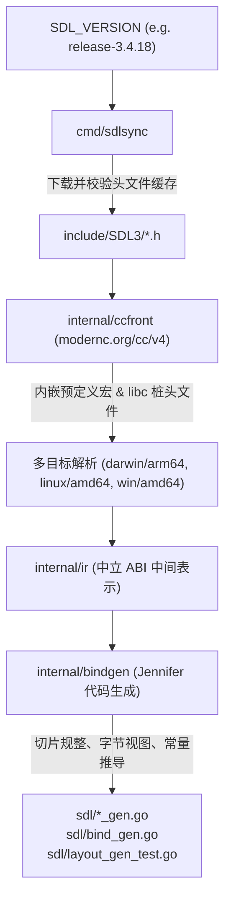
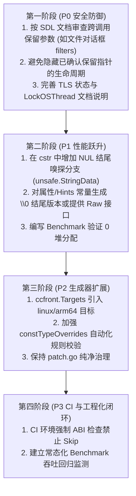

# puresdl 架构审查、性能优化与重构实施指南

> 本文档基于对 [puresdl](file:///Users/tbxark/Repos/opengoui/puresdl) 项目全貌（生成器架构、Purego 运行时内存模型、API 封装模式及测试/CI 体系）的系统性代码审查编制。针对该项目作为 **OpenGoUI 底层基石**（核心诉求：1:1 C ABI 精度、极致性能与零堆分配、内存确定性、轻量透明直通）的定位，提供长效演进与重构参考。

> **实施状态（2026-10-15）**：文件对话框只按 SDL 文档保留筛选器指针；`GetError` 已说明 OS 线程本地语义；NUL 结尾字符串热路径已优化；生成器对所有单字寄存器签名（整数/枚举/bool/指针、≤8 参数，约 1050 个函数）生成零分配直接调用，取代原先 5 个手写 `SyscallN` 快速路径（2026-10-19，见 architecture.md“函数包装规则”）；clang ABI 目标覆盖 Linux 与 Windows ARM64；常量类型守卫、严格 CI ABI 检查和基准已加入。对应基准与剩余可选 Raw API 方案见下文。

---

## 目录

1. [项目定位与核心设计准则](#一项目定位与核心设计准则)
2. [架构全景与数据流](#二架构全景与数据流)
3. [P0 级：内存安全与生命周期风险重构](#三p0-级内存安全与生命周期风险重构)
4. [P1 级：热路径零分配与极致性能优化](#四p1-级热路径零分配与极致性能优化)
5. [P2 级：代码生成器架构健壮性扩展](#五p2-级代码生成器架构健壮性扩展)
6. [P3 级：测试体系与 CI 自动化加固](#六p3-级测试体系与-ci-自动化加固)
7. [分阶段重构实施路线图](#七分阶段重构实施路线图)

---

## 一、项目定位与核心设计准则

[puresdl](file:///Users/tbxark/Repos/opengoui/puresdl) 旨在为 Go 语言提供无 cgo 的纯 Go SDL3 绑定，直接作为 [OpenGoUI](https://github.com/opengoui) GUI 框架的窗口、渲染与事件底层。

### 核心准则

```
┌─────────────────────────────────────────────────────────────┐
│                       OpenGoUI 框架层                       │
│    (负责高层组件树、布局计算、事件分发、主线程调度、回调复用)    │
└──────────────────────────────┬──────────────────────────────┘
                               │
                               ▼
┌─────────────────────────────────────────────────────────────┐
│                      puresdl 底层绑定                       │
│  1. 1:1 C ABI 映射精度：不随意更改 C 原生语义与参数形式       │
│  2. 极致性能与零分配：热路径坚决避免中间堆分配与隐式拷贝     │
│  3. 内存可控与确定性：生命周期明确，严禁产生悬挂指针/隐式GC脱靶│
│  4. 透明轻量直通：不引入全局调度锁、隐式事件循环或过度语法糖  │
└──────────────────────────────┬──────────────────────────────┘
                               │ (purego / dynamic loader)
                               ▼
┌─────────────────────────────────────────────────────────────┐
│                       libSDL3.dylib / .so / .dll            │
└─────────────────────────────────────────────────────────────┘
```

1. **绝对忠实于 SDL3 C ABI**：SDL 函数的返回类型（如 `bool` 返回值与 `SDL_GetError()`）保持 1:1 对应，不随意包装为带开销的 `error` 对象或重构结构体布局。
2. **零隐式堆分配（Zero-Allocation in Hot Paths）**：在事件循环、属性查询、渲染绘制、音频填充等高频热路径中，消除转换层中任何临时对象的创建。
3. **显式内存生命周期**：区分 SDL 内部持有、立即释放与调用方持有，对生命周期延长到函数调用之后的异步入参提供严格的内存存活保障。
4. **底层透明直通**：主线程锁定（`runtime.LockOSThread`）、事件调度以及有限的 Purego 回调槽位（~2000 个上限）复用由上层框架统一协调，底层库避免引入全局互斥锁或隐式注册表。

---

## 二、架构全景与数据流

`puresdl` 的核心由两大部分构成：**离线代码生成工具链** 与 **运行时加载绑定层**。

### 1. 离线生成流水线



### 2. 运行时结构

```mermaid
flowchart LR
    Import["import \"github.com/opengoui/puresdl/sdl\""] --> Init["init() 触发自动加载"]
    Init --> Load["sdl.Load(\"\")"]
    Load --> Candidates["libraryCandidates() (跨平台路径探测)"]
    Candidates --> Purego["purego.Dlopen / syscall.LoadLibrary"]
    Purego --> BindAll["bindAll() / register()"]
    BindAll --> Dynamic["动态绑定符号 (遇到缺失符号安装 panic 桩)"]
```

---

## 三、P0 级：内存安全与生命周期风险重构

> [!CAUTION]
> 这是当前代码库中最高优先级的安全隐患。尽管大多数普通同步 API 能够正常工作，但在涉及**异步回调**与**跨调用指针保留**的函数中，Go 侧分配的临时内存存在严重隐患。

### 1. 异步对话框筛选器的生命周期

#### 问题定位
- 关键文件：[`sdl/dialog_gen.go#L140`](file:///Users/tbxark/Repos/opengoui/puresdl/sdl/dialog_gen.go#L140)（[`ShowOpenFileDialog`](file:///Users/tbxark/Repos/opengoui/puresdl/sdl/dialog_gen.go#L140)、[`ShowSaveFileDialog`](file:///Users/tbxark/Repos/opengoui/puresdl/sdl/dialog_gen.go#L181)）
- 生成器逻辑：[`internal/bindgen/funcs.go#L178-L186`](file:///Users/tbxark/Repos/opengoui/puresdl/internal/bindgen/funcs.go#L178-L186)、[`internal/bindgen/funcs.go#L511-L513`](file:///Users/tbxark/Repos/opengoui/puresdl/internal/bindgen/funcs.go#L511-L513)

#### 机理分析
在 [`ShowOpenFileDialog`](file:///Users/tbxark/Repos/opengoui/puresdl/sdl/dialog_gen.go#L140) 中：
```go
func ShowOpenFileDialog(callback DialogFileCallback, userdata unsafe.Pointer, window *Window, filters *DialogFileFilter, nfilters int32, default_location string, allow_many bool) {
	fnShowOpenFileDialog(callback, userdata, window, filters, nfilters, cstrNull(default_location), allow_many)
}
```
`ShowOpenFileDialog` 是异步函数，但这本身不能证明它会在返回后保留每个入参。SDL 的 API 文档明确要求 `filters`（以及 `ShowSaveFileDialog` 的 `filters`）至少有效到回调触发；文档没有对 `default_location` 声明同样的保留语义。生成器应按参数文档识别生命周期，不能把“异步函数”推断成“所有指针都被保留”。

`filters` 是 SDL 保留的原始指针，调用方必须让筛选器数组及其 `Name`、`Pattern` 指向的数据保持可达，直到回调运行。包装器对此生成 `Keep alive` 文档。`default_location` 仍按普通 C 字符串参数转换；仅凭对话框异步这一点，不能把它描述成已确认的 UAF。依据：SDL 官方 [ShowOpenFileDialog](https://wiki.libsdl.org/SDL3/SDL_ShowOpenFileDialog) 和 [ShowSaveFileDialog](https://wiki.libsdl.org/SDL3/SDL_ShowSaveFileDialog) 文档。

#### 重构改造方案

在 [`internal/bindgen/funcs.go`](file:///Users/tbxark/Repos/opengoui/puresdl/internal/bindgen/funcs.go) 中按 SDL 文档识别**跨调用保留（Retained）**参数。文档标记为保留的 `const char *` 应保持 `*byte` 形式，避免包装器隐藏其生命周期；结构体指针等原始指针参数则生成明确的 Keep alive 注释。异步属性单独不足以触发此规则。

##### 改造方案 A（底层直通 Raw 指针，推荐与 OpenGoUI 配合）
对于文档标记为保留的 `const char *` 参数，不自动将其转换为临时 `string`，而是保持 `*byte` 形式，要求调用方传入生命周期受控的 C 字符串指针：
```go
// 生成器输出：
func SomeRetainingAPI(data *byte) {
    fnSomeRetainingAPI(data)
}
```

文件对话框的调用方应自行持有筛选器数组与其字符串，直到回调完成。自动释放封装需要定义 callback 的线程行为、取消与失败路径、并发多次调用以及 callback 永不返回时的所有权策略，因此不应由通用绑定生成器隐式生成。

---

### 2. 非主线程 Goroutine 的 TLS 状态漂移与错误获取风险

#### 问题定位
- 关键文件：[`sdl/error_gen.go#L50-L70`](file:///Users/tbxark/Repos/opengoui/puresdl/sdl/error_gen.go#L50-L70)（[`GetError`](file:///Users/tbxark/Repos/opengoui/puresdl/sdl/error_gen.go#L50)）

#### 机理分析
SDL3 错误信息保存在操作系统的线程局部存储（TLS, Thread Local Storage）中。
当在非主线程的 Goroutine 中调用 SDL 函数时：
```go
go func() {
    // 假设未调用 runtime.LockOSThread()
    if !sdl.SomeOperation() {
        // <-- Go 调度器可能在此处抢占该 Goroutine 并迁移到另一个 OS 线程
        err := sdl.GetError() // 此时读取的是新 OS 线程的 TLS，很可能为空或陈旧错误！
        log.Println(err)
    }
}()
```

#### 实施与重构指南
1. **文档规范**：在 [`sdl/doc.go`](file:///Users/tbxark/Repos/opengoui/puresdl/sdl/doc.go) 与 [`sdl/error_gen.go`](file:///Users/tbxark/Repos/opengoui/puresdl/sdl/error_gen.go) 显式增加关于 TLS 与 Goroutine 调度的注记。
2. **辅助宏/函数**：在 [`sdl/extra.go`](file:///Users/tbxark/Repos/opengoui/puresdl/sdl/extra.go) 中提供原子式的调用并取错模式：
```go
// GetErrorOnFail 帮助在紧贴调用的同一执行流中读取错误
func CheckBool(ok bool) error {
    if ok {
        return nil
    }
    msg := GetError()
    if msg == "" {
        msg = "SDL call failed with unknown error"
    }
    return errors.New(msg)
}
```

---

## 四、P1 级：热路径零分配与极致性能优化

> [!TIP]
> GUI 框架中高频调用的属性查找、绘制指令与事件轮询应达成 **0 allocs/op**，以保障 120 FPS 渲染时不引起任何 GC 抖动。

### 1. 属性查询与 Hints 的“零拷贝 NUL 结尾嗅探”

#### 原始瓶颈与当前结果
原始 [`cstr`](file:///Users/tbxark/Repos/opengoui/puresdl/sdl/loader.go) 对每个字符串都调用 `CString` 并分配 NUL 结尾副本。现在已先检查末尾字节：NUL 结尾字符串直接经 `unsafe.StringData` 传入 SDL，其他字符串仍复制。`GetNumberProperty` 与其他单字寄存器签名的函数一样由生成的直接调用（`sdl/call.go` 的 `call0 … call8`）绕过函数反射调用分配。

本机 Apple M1 Pro 基准中，NUL 结尾属性名为 `0 B/op, 0 allocs/op`；普通字符串仍为 `32 B/op, 1 alloc/op`。调用方可把频繁使用的名称缓存成 NUL 结尾字符串。

#### 重构方案：零分配 NUL 结尾嗅探 (Zero-Allocation NUL Sniffing)

Go 1.20+ 提供了标准库函数 `unsafe.StringData(s)`。由于 Go 字符串底层内存是只读且不会被 GC 移动的：
- **如果传入的字符串末尾本身就是一个 `\x00` 字符，那么 `unsafe.StringData(s)` 指向的字节序列就是一个天然合法的 C 字符串！**

`sdl/loader.go` 中的 `cstr` 系列已实现该分支：

```go
// cstr 返回一个以 NUL 结尾的 C 字符串指针。
// 若 s 自身已以 NUL 结尾，直接返回其内部只读数据指针，达成 0 堆分配、0 拷贝。
func cstr(s string) *byte {
	if len(s) > 0 && s[len(s)-1] == 0 {
		return unsafe.StringData(s)
	}
	return CString(s)
}

// cstrNull 针对以 NUL 结尾的空字符串或空输入做对应处理
func cstrNull(s string) *byte {
	if s == "" {
		return nil
	}
	if len(s) > 0 && s[len(s)-1] == 0 {
		return unsafe.StringData(s)
	}
	return CString(s)
}
```

`RenderPointsSlice`、`RenderLinesSlice`、`RenderRectsSlice` 和 `RenderFillRectsSlice` 底层的 `fnRender*` 同样是生成的直接调用，避免 `purego.RegisterFunc` 的反射包装。`BenchmarkRenderPointsSlice` 从原先约 `88 B/op, 3 allocs/op, 4.4 µs/op` 降至连续 5 轮 `0 B/op, 0 allocs/op`，耗时中位数约 `311 ns/op`。

#### 配合代码生成器的属性常量优化
在 [`internal/bindgen/funcs.go`](file:///Users/tbxark/Repos/opengoui/puresdl/internal/bindgen/funcs.go) 或 [`internal/bindgen/policy.go`](file:///Users/tbxark/Repos/opengoui/puresdl/internal/bindgen/policy.go) 中，对 `PROP_*` 和 `HINT_*` 常量生成末尾带 `\x00` 的版本，例如：

```go
// 方案一：为属性常量提供 C 友好常量
const (
    PROP_WINDOW_CREATE_TITLE_STRING = "SDL.window.create.title\x00"
    PROP_WINDOW_CREATE_X_NUMBER     = "SDL.window.create.x\x00"
)

// 此时调用：
sdl.GetNumberProperty(props, sdl.PROP_WINDOW_CREATE_X_NUMBER, 0)
// --> 命中 s[len-1] == 0 分支，实现真正的 0 堆分配！
```

#### 进一步扩展：Raw 直通 API
对于热路径，在生成器中对带有 `const char *` 参数的高频函数（如 `Get*Property`、`Set*Property`、`GetHint`、`SetHint`）生成 Raw 版本：
```go
func GetNumberPropertyRaw(props PropertiesID, name *byte, default_value int64) int64 {
    return fnGetNumberProperty(props, name, default_value)
}
```
OpenGoUI 可以在初始化时将所有高频使用的属性名预先转成全局固定的 `*byte`，彻底消除运行时的字符串开销。

---

### 2. 事件循环中 `Event` 变量的逃逸规避

#### 现状机理
在 [`sdl/events_gen.go#L1685`](file:///Users/tbxark/Repos/opengoui/puresdl/sdl/events_gen.go#L1685) 中：
```go
func PollEvent(event *Event) bool {
	return fnPollEvent(event)
}
```
`fnPollEvent` 是未导出的包级函数变量 `var fnPollEvent func(event *Event) bool`。在 Go 编译器的逃逸分析中，穿透函数指针的指针入参必然被标记为 **逃逸到堆（Escape to heap）**。

OpenGoUI 的 SDL `core` 已把 `Event` 保存为复用字段，并在事件循环中传入该字段，避免在轮询循环里逐次声明临时事件值。

#### 优化工程实践
在 OpenGoUI 的架构设计中：
```go
// ❌ 反例：在主循环内声明，导致每轮循环产生堆逃逸压力
for running {
    var event sdl.Event
    for sdl.PollEvent(&event) { ... }
}

// ✅ 推荐：将 Event 实例作为 Application / Window 结构体的内嵌成员常驻复用
type Application struct {
    cachedEvent sdl.Event
}

func (app *Application) Run() {
    for app.running {
        for sdl.PollEvent(&app.cachedEvent) {
            app.handleEvent(&app.cachedEvent)
        }
    }
}
```

---

## 五、P2 级：代码生成器架构健壮性扩展

### 1. 多平台合并补齐 Linux ARM64 与 Windows ARM64

[`internal/ccfront/front.go`](file:///Users/tbxark/Repos/opengoui/puresdl/internal/ccfront/front.go) 当前包含以下五个 ABI 目标：
```go
var Targets = []Target{
	{"darwin", "arm64", "arm64-apple-darwin"},
	{"linux", "amd64", "x86_64-unknown-linux-gnu"},
	{"linux", "arm64", "aarch64-unknown-linux-gnu"},
	{"windows", "amd64", "x86_64-pc-windows-msvc"},
	{"windows", "arm64", "aarch64-pc-windows-msvc"},
}
```
两份 ARM64 预定义宏文件和 Windows ARM64 的 `arm64intr.h` 解析桩已嵌入；`ccfront.Load` 会把这些目标纳入声明与布局合并。生成器与 ABI 布局测试均覆盖目标表。

---

### 2. 带类型常量（Typed Const）启发式推导的规则加固

#### 现状
生成器在 [`internal/bindgen/funcs.go#L87`](file:///Users/tbxark/Repos/opengoui/puresdl/internal/bindgen/funcs.go#L87) 中通过 AST 偏移量推导 `Const.After`，判断宏是否属于前序的整数 `typedef`（如 `WindowFlags`），并在 [`internal/bindgen/policy.go#L99`](file:///Users/tbxark/Repos/opengoui/puresdl/internal/bindgen/policy.go#L99) 中维护了人工审查表 [`constTypeOverrides`](file:///Users/tbxark/Repos/opengoui/puresdl/internal/bindgen/policy.go#L99)。

#### 重构改造动作
在 [`internal/bindgen/consttype_test.go`](file:///Users/tbxark/Repos/opengoui/puresdl/internal/bindgen/consttype_test.go) 中增加自动化守卫测试：
- 遍历所有 `ir.Const`，如果常量名前缀属于常见位掩码（如 `SDL_WINDOW_`、`SDL_INIT_`、`SDL_RENDERER_`），但生成的 Go 常量未被赋予对应的具名类型，则在测试中报告警告或失败，强制同步人员在升级 SDL 版本时评审该常量的归属。

---

## 六、P3 级：测试体系与 CI 自动化加固

### 1. 严格确保 CI 中的 ABI 漂移断言不被跳过

#### 现状
在 [`sdl/abi_test.go#L35-L39`](file:///Users/tbxark/Repos/opengoui/puresdl/sdl/abi_test.go#L35-L39) 中：
```go
want, tag := pinnedVersion(t)
if got := GetVersion(); int(got) != want {
	t.Skipf("loaded SDL3 is %d.%d.%d but the bindings are generated from %s; ABI check needs the matching library", ...)
}
```
`sdl/abi_test.go` 在 `CI` 或 `STRICT_ABI_TEST` 环境下会把 SDL 库缺失或版本不匹配转为失败。CI 下载或构建 `SDL_VERSION` 指定的 release，并在测试阶段设置 `STRICT_ABI_TEST=1`。

---

### 2. 引入微基准与内存分配测试套件 (Benchmark & Alloc Suite)

基准实现位于 [`sdl/benchmark_test.go`](file:///Users/tbxark/Repos/opengoui/puresdl/sdl/benchmark_test.go)，使用 `b.Loop()`，覆盖 NUL 结尾/需复制的属性名以及软件渲染点切片调用。运行：`go test ./sdl -run '^$' -bench '^(BenchmarkGetNumberProperty|BenchmarkRenderPointsSlice)$' -benchmem`。

---

## 七、分阶段重构实施路线图



### 实施检查清单 (Checklist)

- [ ] **Phase 1: 内存安全闭环**
  - [ ] 检查所有带 `keepAliveNote` 和 `taskBufferParam` 的函数列表
  - [ ] 按 SDL 参数文档识别跨调用保留入参；不要仅凭函数异步就推断所有参数均被保留
  - [ ] 在 `sdl/doc.go` 明确说明 TLS 错误获取与 `runtime.LockOSThread()` 的协同要求
- [ ] **Phase 2: 零分配优化验证**
  - [ ] 在 [`sdl/loader.go`](file:///Users/tbxark/Repos/opengoui/puresdl/sdl/loader.go) 实现 `cstr` 的 `s[len-1] == 0` 直通
  - [ ] 为 Properties / Hints API 评估增加 Raw 变体或 NUL 结尾常量
  - [ ] 运行 `go test -bench=. -benchmem ./sdl` 确认热点查询达到 `0 B/op, 0 allocs/op`
- [ ] **Phase 3: 生成器完备性**
  - [ ] 导出 clang linux-arm64 预定义宏并注册至 `ccfront.Targets`
  - [ ] 执行 `go run ./cmd/sdlsync -generate` 确认跨目标对齐警告为 0
- [ ] **Phase 4: CI 防御升级**
  - [ ] 在 CI 流程中锁定 ABI 测试必须 PASS，禁止因为环境偏差被静默跳过

---

*文档完结。此文档可直接作为开发团队开展代码重构、性能压测与安全加固的技术指引与实施蓝图。*
